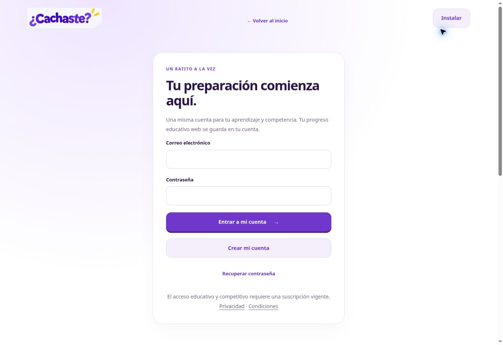

# ¿Cachaste? — despliegue real de prueba

La primera vista de prueba está desplegada y verificada en Cloudflare Pages. La contratación y el registro comercial continúan cerrados. No es una autorización de lanzamiento comercial.

- [Abrir la web publicada](https://work-cachaste-web-comercial.cachaste-sitecacho.pages.dev/).
- [Despliegue inmutable verificado](https://076cfdbb.cachaste-sitecacho.pages.dev/).
- [Código desplegado: 54739c9](https://github.com/josevillablanca30/PreparaTupaes/commit/54739c957992672348bbbe051754e790ce43dd3e).
- [QA completa de ese commit](https://github.com/josevillablanca30/PreparaTupaes/actions/runs/40197831407).
- [Detalle de las 202 comprobaciones HTTP](verificacion.json).

## Implementado

Proyecto independiente `cachaste-sitecacho`, creado por la API oficial en la cuenta confirmada del titular. Producción reservada en `production-requires-owner-approval`, sin despliegues de producción. No se cambiaron planes ni se activaron cobros. La aplicación Android, sus archivos nativos y la conexión de `somosvillablanca.cl` con Lovable no se modificaron.

Se configuraron Fail closed tanto en preview como en producción y claves privadas como `secret_text`. Los 94 archivos educativos privados se distribuyen cifrados con AES-256-GCM; no existe un directorio `/app` en claro en la distribución. El acceso requiere Auth y permiso Premium verificado por el servidor. El token de Cloudflare no se incluyó en el código, artefactos ni variables de ejecución de la aplicación: se utilizó solamente en memoria durante la sesión de despliegue.

El workflow fija el identificador público de cuenta, rechaza cuentas/proyectos ajenos y requiere un solo secreto de repositorio: `CLOUDFLARE_API_TOKEN`. El conector GitHub disponible no administra secretos. Por eso la publicación actual se hizo con Wrangler y la API oficial desde Work, después de verificar la QA de GitHub Actions del mismo SHA. El workflow de publicación automática todavía se detiene si ese secreto no está guardado.

## Probado

- 394 pruebas del motor educativo original y 83 de backend/seguridad web, sin fallos.
- 112 pruebas automatizadas de navegador: 28 en cada perfil Android-Chrome, iPhone-WebKit, Desktop-Chrome y 320 px. No son pruebas en teléfonos físicos.
- Integración HTTP con Auth/PostgREST reales en un backend efímero de CI: sesiones, persistencia, RLS y duelos. No se crearon alumnos ni permisos ficticios en el Supabase alojado compartido con Android.
- Cifrado autenticado de los 94 archivos privados y cinco bancos, sin clave incorporada al Worker ni archivos educativos públicos.
- **202/202 comprobaciones sobre el despliegue HTTPS real**, incluidos todos los archivos privados y sus rutas cifradas, rechazo de JWT fabricado, sesión/progreso/checkout anónimos, protección de origen, PWA y cobros deshabilitados.
- Revisión visual real en Chrome de landing y cuenta, con capturas sin credenciales. La cuenta terminó de cargar y se verificó la navegación de ida y vuelta.

La prueba alojada permitió corregir dos diferencias del proveedor: Pages redirigía los HTML públicos a rutas sin extensión y el Auth alojado devolvía 403 para un JWT inválido. El Worker conserva ahora las URLs públicas originales al resolver el alias interno y normaliza los rechazos de identidad a 401, manteniendo bloqueado el contenido. Se añadieron pruebas para ambos casos y para impedir seguir redirecciones de archivos a otro origen/ruta inesperada.

## Dominio .cl y DNS pendiente

`sitecacho.cl` y `www.sitecacho.cl` ya fueron asociados al proyecto mediante la API; Cloudflare respondió `initializing`. Los nameservers públicos ya son `johnny.ns.cloudflare.com` y `maxine.ns.cloudflare.com`: no hay que repetir el cambio en NIC Chile.

Los dominios todavía no sirven la aplicación verificada: la consulta HTTPS de `/api/config` devolvió 503. Falta ajustar los registros de **la zona sitecacho.cl** para la rama de prueba:

| Tipo | Nombre | Destino | Proxy | TTL |
| --- | --- | --- | --- | --- |
| CNAME | @ | work-cachaste-web-comercial.cachaste-sitecacho.pages.dev | Activado | Auto |
| CNAME | www | work-cachaste-web-comercial.cachaste-sitecacho.pages.dev | Activado | Auto |

El destino es el alias real devuelto por Pages, no una transformación supuesta del nombre de rama. Debe usarse proxy activado para enlazar una rama; DNS only llevaría a producción, que está reservada y no publicada. El token usado solo permite Pages Edit: no se solicitaron permisos DNS ni se modificaron registros de zonas por API.

Después de guardar esos CNAME, verificar el estado Active del dominio, el certificado y que `/api/config` devuelva la revisión del despliegue esperado, antes de declarar listo el dominio. No cambiar la zona de Somos Villablanca.

## Pendiente para operar y vender

- Reemplazar el token que el titular compartió en el chat y guardar el nuevo directamente en GitHub Actions como `CLOUDFLARE_API_TOKEN` para futuras publicaciones automáticas. Revocar el token de despliegue no elimina la aplicación ya publicada.
- Terminar DNS/certificado .cl y revisar retornos Auth, confirmación/recuperación de correo y SMTP, conservando los retornos Android.
- Probar una identidad autorizada y su acceso Premium real en el dominio, teléfonos físicos y PWA instalada. La revisión pública no concede Premium ni habilita compras.
- Conectar y probar Mercado Pago en sandbox aislado, confirmar cuenta/giro/documentos tributarios y autorizar por separado el inicio de ventas reales. Los pagos probados en CI utilizan simulaciones del proveedor.
- Resolver la visibilidad pública del repositorio antes de vender exclusividad del banco: el cifrado de Pages no vuelve privado el historial original de GitHub. No borrar contenido ni reescribir la candidata Android para ocultarlo.
- Sin prueba de carga de 200 usuarios ni garantía de uso ilimitado en los planes gratuitos.

## Capturas reales del sitio publicado

Landing, Chrome de escritorio:

Cuenta, sin iniciar sesión ni introducir datos personales:

