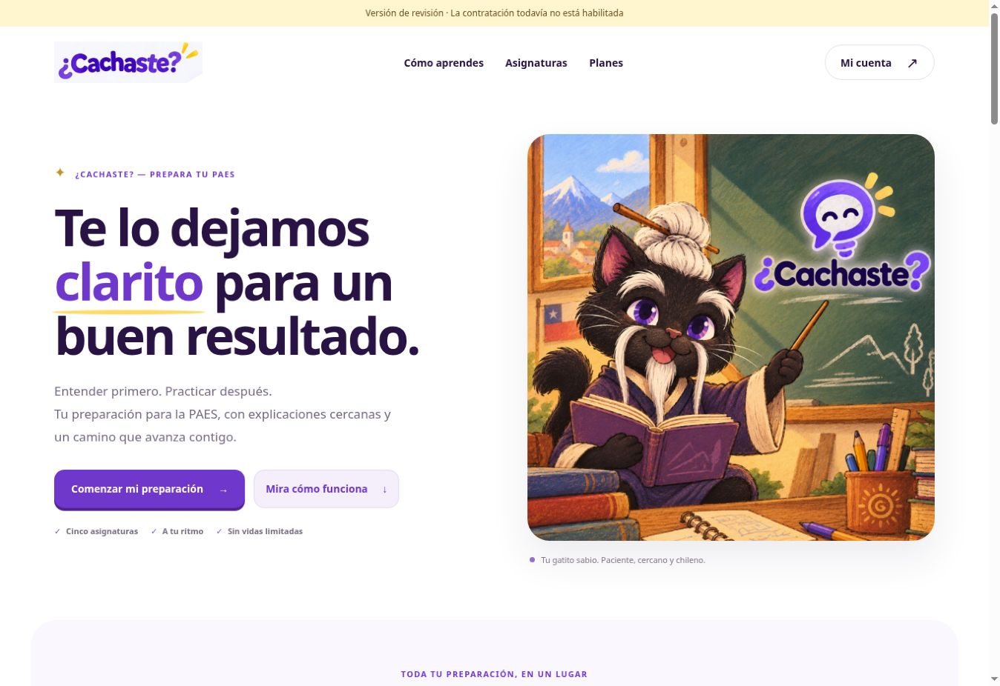
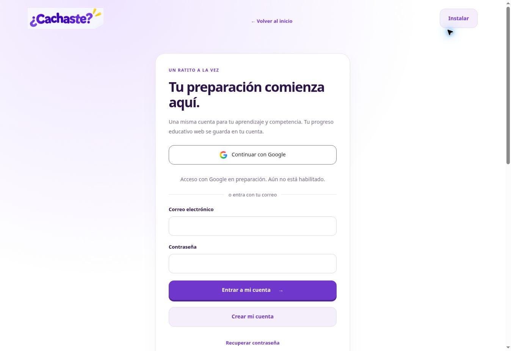
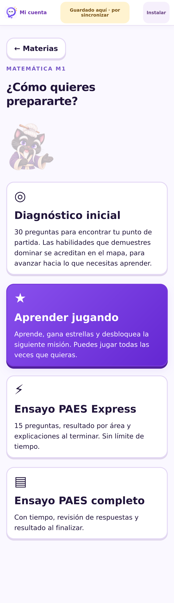
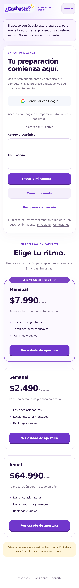
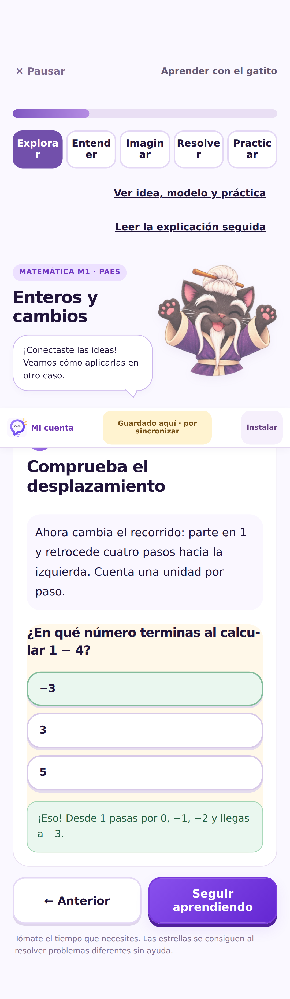
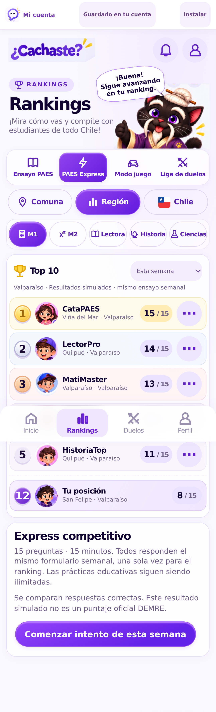
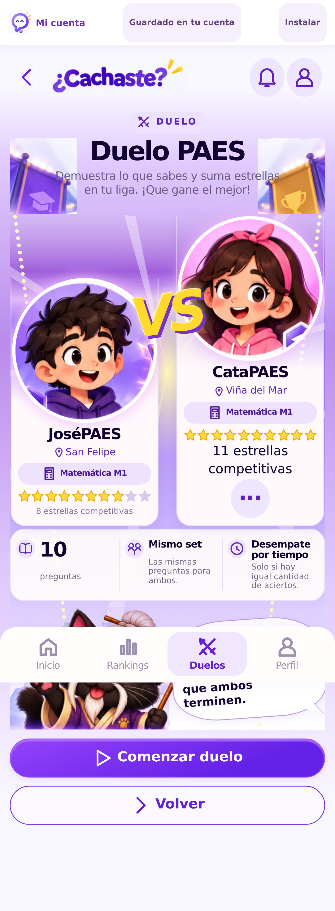

# ¿Cachaste? Web — cierre técnico del 25 de octubre de 2026

La rama web continúa desde 56eada2 y conserva íntegros el motor, los 802 ejercicios y la candidata Android. Los cobros reales y la apertura del registro en la interfaz web permanecen cerrados. La configuración global de Auth compartida con Android no se alteró. Este informe distingue código implementado, pruebas en entornos aislados y comprobaciones reales del despliegue.

## Entrega verificable

- [Abrir la versión web actual](https://work-cachaste-web-comercial.cachaste-sitecacho.pages.dev/).
- [Preview inmutable de esta revisión](https://69cfd5f2.cachaste-sitecacho.pages.dev/).
- [Código probado y desplegado: 3889274](https://github.com/josevillablanca30/PreparaTupaes/commit/38892741771432f56e49fc875e4384de3e0de144).
- [GitHub Actions: seis trabajos aprobados sobre ese mismo SHA](https://github.com/josevillablanca30/PreparaTupaes/actions/runs/40240767535).
- [Resumen legible por máquinas](resumen.json), [202 comprobaciones HTTPS](verificacion-https.json), [estado real de servicios y DNS](estado-servicios.json).

Se utilizó QA de GitHub Actions y después Wrangler/API oficiales desde Work. El secreto Actions todavía no está guardado mediante el conector: no se presenta este despliegue como una ejecución de Actions de publicación. Producción continúa reservada en `production-requires-owner-approval`, sin publicar. La zona `somosvillablanca.cl`, Lovable, los archivos de la candidata Android y las funciones Google Play existentes quedaron fuera de las modificaciones.

## Implementado en esta pasada

- Entrada Google con PKCE S256, SDK único para cuenta y competencia, validación del proveedor configurado, destino interno permitido y limpieza de códigos/errores del historial. La imagen Google G procede de Google y se sirve localmente; el gatito y el logo de ¿Cachaste? no cambian.
- Renovación de la cookie HttpOnly y de la licencia offline durante una sesión larga. Recuperación al volver a la pestaña, regresar desde segundo plano o recuperar conexión. No se ejecutan llamadas asíncronas dentro del lock de Auth.
- Cambio de estudiante: pausa del envío, borrador conservado bajo su UUID y rechazo de una escritura con la cookie de otra identidad. Desde Mi cuenta, un acceso sin Premium elimina la autorización y el caché offline anteriores.
- Perfil y eliminación disponibles después de vencer Premium. Cada HTML vuelve a consultar el permiso actual; el caché de archivos ya no provoca una lectura educativa prohibida al abrir Perfil.
- Eliminación de una cuenta Google sin pedir una contraseña local. Conserva confirmación explícita, identidad verificada y el requisito del servidor de una sesión reciente. La cancelación de renovación sigue siendo una acción separada.
- Protección de retornos Auth: no-referrer, no-store y exclusión de parámetros de autorización del caché PWA. www.sitecacho.cl redirige al origen principal sitecacho.cl, sin reglas ni cambios en otros dominios.
- Cobertura de renovaciones, cancelaciones, rechazos y reembolsos de los planes semanal, mensual y anual. Los importes de servidor son $2.490, $7.990 y $64.990. La promoción de siete días depende del plan oficial validado; no se anuncia como activa actualmente.

## Motor y contenido conservados

Cinco asignaturas, cuatro opciones de Ciencias, camino de aprendizaje, lecciones visuales, tutor, diagnósticos, Express, ensayos completos, estadísticas e historial. Se conservan los cuatro rankings independientes y sus filtros por asignatura, comuna, región y Chile. Duelos asincrónicos: diez preguntas iguales, evaluación y tiempos de servidor, +1/-1/0 con mínimo cero y revisión educativa al terminar ambos.

La revisión estructural de 802 preguntas tiene cero alertas críticas y veinte avisos editoriales: dos enunciados breves y dieciocho alternativas con absolutos. Estos avisos no son errores confirmados ni una certificación de adecuación lectora. En 32 sesiones de práctica consecutiva se registraron 160 respuestas, veinte por asignatura/opción de Ciencias, sin repetir preguntas y con persistencia verificada. Las pruebas originales también cubren repaso espaciado, familias independientes, recuperación y que una misma familia no otorgue dominio ficticio.

## Pruebas ejecutadas

Todas corresponden al código `3889274`. Los seis trabajos del run enlazado terminaron con `success`.

| Comprobación | Resultado | Alcance real |
| --- | ---: | --- |
| Motor y competencia originales | 394 aprobadas, 0 fallos | Regresión de reglas educativas y nativas originales |
| Backend, Auth, PWA, pagos y controles web | 105 aprobadas, 0 fallos | Node, sin compras reales |
| Android Chrome | 35 aprobadas | Chromium, perfil Pixel 7 |
| iPhone WebKit | 35 aprobadas | WebKit, perfil iPhone 13; no dispositivo físico |
| Chrome de escritorio | 35 aprobadas | Chromium |
| Móvil de 320 px | 35 aprobadas | Chromium, pantalla estrecha |
| Auth/PostgREST por HTTP, progreso web | 9 aprobadas | Supabase efímero real en CI |
| Auth/PostgREST por HTTP, competencia original | 17 aprobadas | Dos alumnos, 10 versus 10, reconexión, resultados y clasificaciones persistentes |
| Preview pública por HTTPS | 202 aprobadas, 0 fallos | Todas las rutas privadas y sus cifrados, no solo una muestra |
| Integridad Android | Aprobada | Archivos originales idénticos byte a byte a `add8a5979d28cb1f7598767bb4bf1ad7b8328937` |
| Selección y persistencia | 160 respuestas, 0 repetidas | 32 sesiones, ocho asignaturas/opciones de Ciencias |

Los 140 recorridos de navegador incluyen las cinco asignaturas, diagnóstico, lecciones, Express, ensayos, persistencia, PWA, offline, expiración, cambio de identidad, PKCE, cancelación de Google y administración sin Premium. La comparación visual de Rankings, Duelos, VS y Resultados contra la interfaz original aprobó el límite de diferencia del 2,5 % en los perfiles de la matriz. No se afirma una comparación contra nuevas imágenes aprobadas que no hayan sido adjuntadas.

Los JSON HTTP se conservan en [progreso y seguridad](real-http-integration.json) y [competencia y duelos](competition-online-integration.json). Son cuentas y permisos desechables del entorno aislado, nunca alumnos ficticios ni Premium artificial en el Supabase compartido alojado. La simulación Google verifica el SDK, consentimiento aislado, PKCE y retorno; no sustituye iniciar con una cuenta real del proveedor.

Comandos reproducibles: `node web/scripts/verify-android.mjs`, `npm run test:logic`, `node --test web/tests/*.test.mjs`, `node web/scripts/build.mjs`, `node web/scripts/verify-private-distribution.mjs --local` y `npx playwright test --config=web/playwright.config.mjs`. El workflow `web-commercial.yml` también prepara y destruye el backend efímero para las pruebas HTTP.

## Despliegue, dominio y protección Premium

La preview entrega landing, cuenta y PWA por HTTPS. Los 94 archivos educativos están cifrados con AES-256-GCM, con cero copias educativas claras en la distribución y sin clave incorporada al Worker. Pages mantiene Fail closed en preview y producción. Los controles reales rechazan JWT fabricado, acceso anónimo al banco, progreso, checkout y solicitudes de otro origen. La revisión pública de cuenta confirmó `no-referrer` y `private, no-store`.

En el Supabase alojado se verificaron `payments_enabled=false`, `tax_ready=false` y `allow_test_purchases=false`. El proveedor Google devuelve deshabilitado; la preview declara también Google y registro web cerrados. Los avisos de seguridad son informativos de RLS sin políticas públicas en los esquemas privados; no se abrieron tablas para eliminarlos.

**sitecacho.cl todavía no está operativo con la aplicación.** Los dos dominios están asociados al proyecto con estado `pending`; las consultas de `/api/config` devolvieron 503, sin la revisión esperada. Los nameservers ya son `johnny.ns.cloudflare.com` y `maxine.ns.cloudflare.com`. No hay que repetir el paso de NIC Chile.

Acción manual imprescindible: en **Cloudflare > sitecacho.cl > DNS > Records**, crear o ajustar únicamente estos registros:

| Tipo | Nombre | Destino | Proxy | TTL |
| --- | --- | --- | --- | --- |
| CNAME | @ | work-cachaste-web-comercial.cachaste-sitecacho.pages.dev | Activado, nube naranja | Auto |
| CNAME | www | work-cachaste-web-comercial.cachaste-sitecacho.pages.dev | Activado, nube naranja | Auto |

El alias es el devuelto por Pages. El proxy activado es necesario para asociar la rama de prueba: [documentación oficial de Cloudflare](https://developers.cloudflare.com/pages/how-to/custom-branch-aliases/). El token limitado no permite modificar DNS. Después hay que verificar Active, certificado, navegación y revisión de `/api/config`. No se ejecutaron operaciones sobre la zona de Somos Villablanca, ni se reintentó entrar al panel automatizado.

## Dependencias reales antes de abrir ventas

1. DNS: conservar los nameservers de NIC Chile ya verificados. Revisar o crear únicamente en la zona sitecacho.cl los CNAME @ y www hacia el alias de rama real, con proxy activado y TTL automático. No intervenir somosvillablanca.cl.
2. Google: Client ID/Secret en el proveedor de Supabase y retornos web autorizados, manteniendo los Android. El código y la simulación no equivalen a un acceso con una cuenta Google real.
3. Correo y datos definitivos: SMTP/retornos para confirmación y recuperación por correo, información del responsable y documentos del servicio. No habilitar registro público antes de su verificación.
4. Mercado Pago: cuenta, credenciales TEST/producción, receptor, planes MLC, secreto de webhook y verificación oficial del mecanismo de siete días. El sandbox real del proveedor sigue pendiente; las pruebas ejecutadas hasta ahora usan simulación aislada, sin cobrar.
5. SII: regularización y documentación de ventas correspondientes. Inicio de Actividades, giro, IVA y emisión de boletas no se dan por aprobados ni se suponen resueltos. Los reportes CSV no reemplazan documentos tributarios.
6. Repositorio: resolver su visibilidad antes de vender contenido como exclusivo; las fuentes e historial originales son públicos. El cifrado web no retira copias previamente públicas. No se borra ni reescribe Android para resolverlo.
7. Operación: sustituir el token compartido en el chat y guardar el nuevo directamente como CLOUDFLARE_API_TOKEN en los secretos Actions del repositorio para automatizar las siguientes previews. No enviar claves por chat.

## Pendientes técnicos explícitos

Acceso Google y recuperación reales sobre .cl; checkout y notificaciones del sandbox oficial con credenciales del titular; recorrido con Premium verificado en el alojamiento; dos teléfonos físicos; carga de aproximadamente 200 usuarios y seguimiento de las cuotas Free. La importación del progreso local de la candidata Android requiere una actualización futura separada. No se ha modificado la APK, no se han contratado servicios ni activado cobros.

La implementación de estas conexiones está preparada para configurarse y verificarse; los trámites tributarios por sí solos no sustituyen esas comprobaciones externas.

## Commits guardados en la rama web

| Commit | Cambio |
| --- | --- |
| [756120c](https://github.com/josevillablanca30/PreparaTupaes/commit/756120cd3b8efa0a8f0429429d244206ad760b10) | Google PKCE y renovación de sesiones vinculadas a la cuenta |
| [2ef9ade](https://github.com/josevillablanca30/PreparaTupaes/commit/2ef9ade6aff984bd7ffeb54bb1959be1b706c3ce) | Eliminación Google y conservación de sesión durante los recorridos |
| [71aedc6](https://github.com/josevillablanca30/PreparaTupaes/commit/71aedc6ca576c6d148f4f6ff27392bf0cbc74207) | Descubrimiento temprano de pruebas y renovaciones de los tres planes |
| [3750cc9](https://github.com/josevillablanca30/PreparaTupaes/commit/3750cc93a6cdfd583084d1ac507389228659464a) | Perfil accesible al caducar Premium y validación fresca del HTML |
| [7201d78](https://github.com/josevillablanca30/PreparaTupaes/commit/7201d7802644c4be64498e6455d4eae1f9303b5d) | Recorrido PKCE de prueba compatible con WebKit |
| [2749ff3](https://github.com/josevillablanca30/PreparaTupaes/commit/2749ff30280d59cc7e699d43c1726a7f2397a26f) | Códigos OAuth fuera del caché y origen canónico sitecacho.cl |
| [3889274](https://github.com/josevillablanca30/PreparaTupaes/commit/38892741771432f56e49fc875e4384de3e0de144) | Purga de licencia/caché anteriores al cambiar o cerrar el acceso |

La evidencia de este directorio y los índices de documentación se guardan después, sin cambios de código ni un nuevo despliegue. La revisión servida sigue siendo `3889274`.

## Archivos modificados

[Listado exacto de los 25 archivos de implementación de esta pasada](archivos-modificados.txt). Todos pertenecen a `web/`, salvo el workflow web independiente. Los grupos principales son Auth/cuenta/sesión, progreso y shell; gateway y adaptadores competitivos exclusivos de web; service worker y estilos; preparación/verificación de Pages; pruebas automatizadas y documentación. No se alteraron bancos, estilos o configuración nativa de Android.

## Capturas reales y límites visuales

Las dos primeras capturas proceden de la URL HTTPS pública de esta revisión, sin ingresar credenciales. Las capturas móviles proceden de navegadores ejecutando el código final en CI con el backend de pruebas; no representan acceso Premium concedido en producción. Las comparaciones automatizadas se basan en la interfaz competitiva original, no en imágenes nuevas ausentes.

### Landing publicada, Chrome

### Cuenta publicada, Chrome

El aviso distingue proveedor preparado de proveedor habilitado.

### iPhone WebKit: preparación M1

### iPhone WebKit: cuenta y Google

### Android Chrome: lección M1

Captura de página completa: la barra fija conserva la posición de la ventana al capturar; esa composición no es una barra colocada dentro de la lección.

### Android Chrome: rankings

### Android Chrome: duelo

