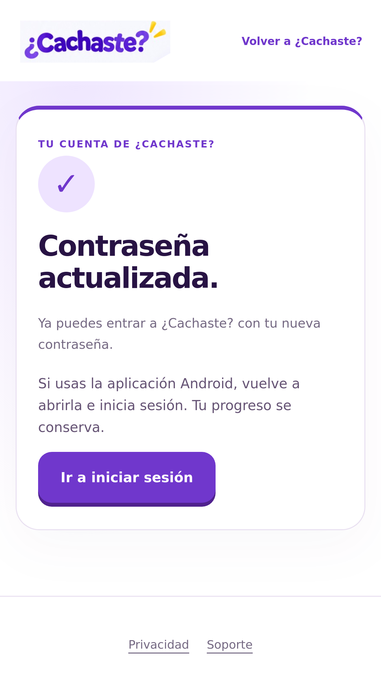
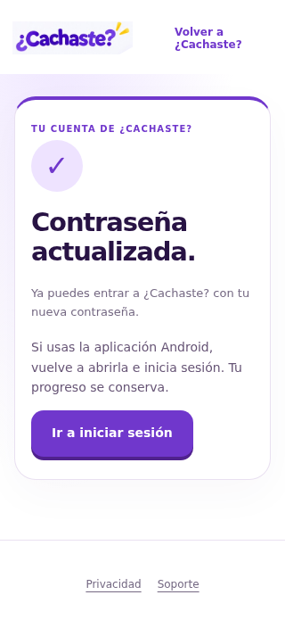

# ¿Cachaste? · Recuperación de cuentas

Fecha de trabajo: 2 de noviembre de 2026, Chile.

**Implementada y probada; publicación y configuración alojada bloqueadas por acceso. La misión todavía no está terminada.**

## Código guardado

Repositorio y rama: `josevillablanca30/PreparaTupaes`, `work/cachaste-web-comercial-20261024`. Se continuó desde el remoto `83ac3a09`, sin reiniciar ni sobrescribir Android.

| Commit | Cambio |
|---|---|
| [389756d7](https://github.com/josevillablanca30/PreparaTupaes/commit/389756d7e9ad79efd19369e035b5f20401908a76) | Página pública, integración Supabase oficial, plantilla chilena, configuración segura y pruebas |
| [d2ce03a5](https://github.com/josevillablanca30/PreparaTupaes/commit/d2ce03a579bb652996ebc5f82e264ce6da298141) | Envío de formularios y compatibilidad con refresh tokens antiguos |
| [31d4dfbd](https://github.com/josevillablanca30/PreparaTupaes/commit/31d4dfbdf254b8a24715225dd7ee1661b4e77e5d) | Segundo enlace en la misma pestaña y reintento de conexión Safari |

[Lista de los 27 archivos de implementación](archivos-modificados.txt). Este informe, las evidencias y las capturas se agregan en el commit de cierre. Se refuerza además la prueba HTTP para solicitar el correo con PKCE y verificar el hash desde otro cliente, como cuando Gmail abre un navegador distinto.

La página `/recuperar` conserva el diseño de la web existente. Valida hashes, sesiones implícitas Android y códigos PKCE mediante el SDK oficial; elimina el callback del historial antes de otras solicitudes; permite cambiar contraseña, pedir otro correo y volver a iniciar sesión. Incluye errores seguros, reintento de red, espera de 60 segundos para reenviar y validación de contraseña y confirmación. No depende de una suscripción, de Premium ni del estado de cobros.

## Resultados automatizados verificados

Fuente de la evidencia incorporada: `31d4dfbdf254b8a24715225dd7ee1661b4e77e5d`.

| Comprobación | Resultado |
|---|---|
| Lógica original de la aplicación | 394 aprobadas, 0 fallas |
| Lógica y backend web | 114 aprobadas, 0 fallas |
| Chrome Android | 42 aprobadas, 0 fallas |
| Safari/WebKit iPhone | 42 aprobadas, 0 fallas |
| Chrome escritorio | 42 aprobadas, 0 fallas |
| Pantalla de 320 px | 42 aprobadas, 0 fallas |
| Recuperación con Supabase Auth y correo SMTP locales reales | 9 comprobaciones aprobadas, 0 fallas |
| Regresión HTTP de cuentas, duelos, RLS y progreso | Aprobada |
| Contenido educativo | 94 archivos cifrados; 0 bancos de preguntas en texto público |
| Protección Android | Código y bancos originales sin cambios |

Ejecuciones: [QA completa](https://github.com/josevillablanca30/PreparaTupaes/actions/runs/41551147391) y [recuperación HTTP y control de accesos](https://github.com/josevillablanca30/PreparaTupaes/actions/runs/41551147339). El estado global de la segunda ejecución es fallido por credenciales administrativas ausentes; su trabajo `recovery-http` sí aprobó. `configure-hosted` se omitió y no escribió en producción.

| Prueba exigida | Evidencia y límite |
|---|---|
| Solicitud desde Android | Se ejecutó el método real de `CompetitionClient` de la rama Android vigente contra Auth local. Falta la app instalada y el proyecto alojado. |
| Recepción de correo | Se recibió y leyó el HTML renderizado por Auth en SMTP local. Gmail/Resend alojados no se probaron con esta plantilla nueva. |
| Apertura del enlace en teléfono | Recorridos de Chrome Android y WebKit iPhone aprobados. Falta teléfono físico. |
| Nueva contraseña | Cambio real en Auth local mediante el hash del correo, SDK oficial y usuario validado. |
| Login con la nueva | Aprobado contra Auth local. |
| Rechazo de la anterior | Aprobado contra Auth local. |
| Enlace expirado | Se hizo vencer el token en el servidor local y se comprobó su rechazo. |
| Enlace reutilizado | Rechazo del hash consumido en Auth real local y en la pantalla web, incluso en la misma pestaña. |
| Solicitud repetida | Dos correos distintos en SMTP local; el último enlace valida. El navegador comprueba la espera de 60 segundos. |
| Errores de conexión | Chrome y WebKit muestran reintento, conservan el callback solo en memoria y no anuncian cambios no realizados. |

[Resultado HTTP sin secretos](recovery-http.json). Los navegadores usan respuestas Auth simuladas para probar la UI; las nueve pruebas HTTP sí usan Auth, contraseñas y SMTP locales reales y cuentas desechables. Ninguna equivale a haber recuperado una cuenta alojada en un teléfono físico.

## Publicación real

Proyecto Cloudflare Pages existente: `cachaste-sitecacho`, independiente de Servicios Villablanca. Cuenta pública: `cfe4b77c0c39bb056306d16133a93642`. No se creó infraestructura de pago ni se habilitaron cobros o suscripciones.

URL HTTPS existente: https://work-cachaste-web-comercial.cachaste-sitecacho.pages.dev

Destino preparado: `https://work-cachaste-web-comercial.cachaste-sitecacho.pages.dev/recuperar`. **Todavía no contiene la recuperación nueva.** La versión pública comprobada es `38892741771432f56e49fc875e4384de3e0de144`; `/recuperar` devuelve la portada antigua por fallback. [Comprobación HTTPS](public-deployment.json).

El [intento de publicación](https://github.com/josevillablanca30/PreparaTupaes/actions/runs/41528400582) se detuvo antes de escribir: `CLOUDFLARE_API_TOKEN_REQUIRED_IN_GITHUB_SECRETS`. No se declara publicado por tener un HTML compilado, un artefacto o un HTTP 200 de la portada antigua.

## Acceso exacto que falta

Los siguientes secretos no están disponibles en GitHub Actions:

| Nombre en GitHub | Acceso necesario |
|---|---|
| `CLOUDFLARE_API_TOKEN` | Cloudflare Pages Edit limitado a la cuenta existente y al proyecto de ¿Cachaste? |
| `SUPABASE_ACCESS_TOKEN` | Administración de la configuración Auth del proyecto `jmobinmdwrmdqrxtcruj` |

Se guardan en **Settings → Secrets and variables → Actions → Repository secrets** del repositorio. No enviarlos por chat ni usar las claves SMTP. No sirve la publishable key pública como credencial administrativa. Utilizar los accesos existentes cuando estén disponibles; no se necesita crear otra API key de Resend.

También se revisaron los paneles: ambos requieren iniciar sesión en este entorno y no hay una sesión administrativa disponible. No se registran ni copian contraseñas de acceso.

Con los accesos disponibles, ejecutar en la rama web, para el mismo commit:

1. `web-commercial.yml`: QA completa y distribución protegida.
2. `web-pages-preview.yml`: espera la QA del mismo commit, publica Pages Free y verifica HTTPS, versión, ruta, JS, seguridad y cobros desactivados.
3. `web-auth-recovery.yml`: espera la versión publicada y aplica/relee la configuración Auth. Repetir los workflows sobre el HEAD vigente si un commit de documentación es más reciente que la QA.

## Configuración Supabase y correos

**Aplicada durante esta misión: ninguna modificación alojada.** Las credenciales SMTP de Resend permanecen intactas. El retorno real a localhost sigue pendiente de publicar y aplicar la configuración preparada.

El script `web/scripts/configure-auth-recovery.mjs` comprueba la página pública y su versión antes de escribir. Cambia exclusivamente:

- Site URL al origen HTTPS de Pages.
- Redirect URLs: agrega `/recuperar` y `/cuenta.html?recovery=1`, conserva destinos previos que no sean locales y quita localhost/loopback.
- Nombre de remitente: `¿Cachaste?`.
- Asunto: `¿Cachaste? — Recupera tu contraseña`.
- HTML de recuperación: botón `Cambiar mi contraseña`, código numérico Android y aviso de seguridad.

El script relee la configuración y exige que host, puerto, usuario, contraseña, dirección SMTP y confirmación de correo sigan iguales. No genera claves SMTP, no inicia cobros ni cambia contraseñas de usuarios alojados.

El botón nuevo lleva el hash en el fragmento, usa `verifyOtp` y evita depender del navegador que originó la petición. El código permite continuar dentro de Android. La plantilla usa el Site URL verificado; no se incorporan tokens a enlaces secundarios, errores o registros propios.

## Entregabilidad

Según la comprobación previa del titular, Resend entrega y Gmail recibe el correo antiguo, actualmente en Spam. No se atribuye a esta implementación una nueva entrega alojada ni una solución del spam.

[Auditoría DNS pública](mail-dns-audit.json): SPF encontrado en `send.auth.sitecacho.cl`; DKIM encontrado en `resend._domainkey.auth.sitecacho.cl`; DMARC no encontrado en `_dmarc.auth.sitecacho.cl` ni `_dmarc.sitecacho.cl`. No se modificó DNS. La presencia de registros no prueba los resultados de autenticación del mensaje real en Gmail.

Registro inicial de monitorización propuesto, aún no aplicado: TXT en `_dmarc.auth.sitecacho.cl`, valor `v=DMARC1; p=none;`. Sin inventar una casilla de reportes. Después se deben revisar los encabezados SPF/DKIM/DMARC del mensaje real y su llegada a Recibidos o Spam.

## Validación humana que falta

Después de publicar y configurar, el titular debe completar este recorrido con su teléfono y una cuenta de prueba propia:

1. Pedir **un correo nuevo** desde la aplicación Android instalada.
2. Confirmar recepción y asunto; revisar también Spam. No usar un mensaje antiguo con localhost.
3. Tocar `Cambiar mi contraseña` y confirmar que abre la página HTTPS de ¿Cachaste?.
4. Elegir, confirmar y enviar una contraseña nueva de al menos doce caracteres, sin compartirla por chat.
5. Volver a la aplicación e iniciar sesión con ella; comprobar el rechazo de la anterior.
6. Volver a abrir el botón del mismo mensaje y comprobar el aviso de enlace ya usado y la opción de pedir otro.

El código numérico del mismo correo ofrece el recorrido alternativo dentro de Android. La web indica volver a abrir la aplicación; no se promete un enlace profundo que el AAB actual no tiene configurado.

**Nuevo AAB: no es necesario.** No se cambió código Android ni se generó un archivo nuevo. La validación del AAB instalado y del correo alojado queda pendiente, no se presenta como prueba automatizada.

## Capturas de QA

Capturas de navegadores de prueba, no de un usuario recuperando una cuenta alojada:

