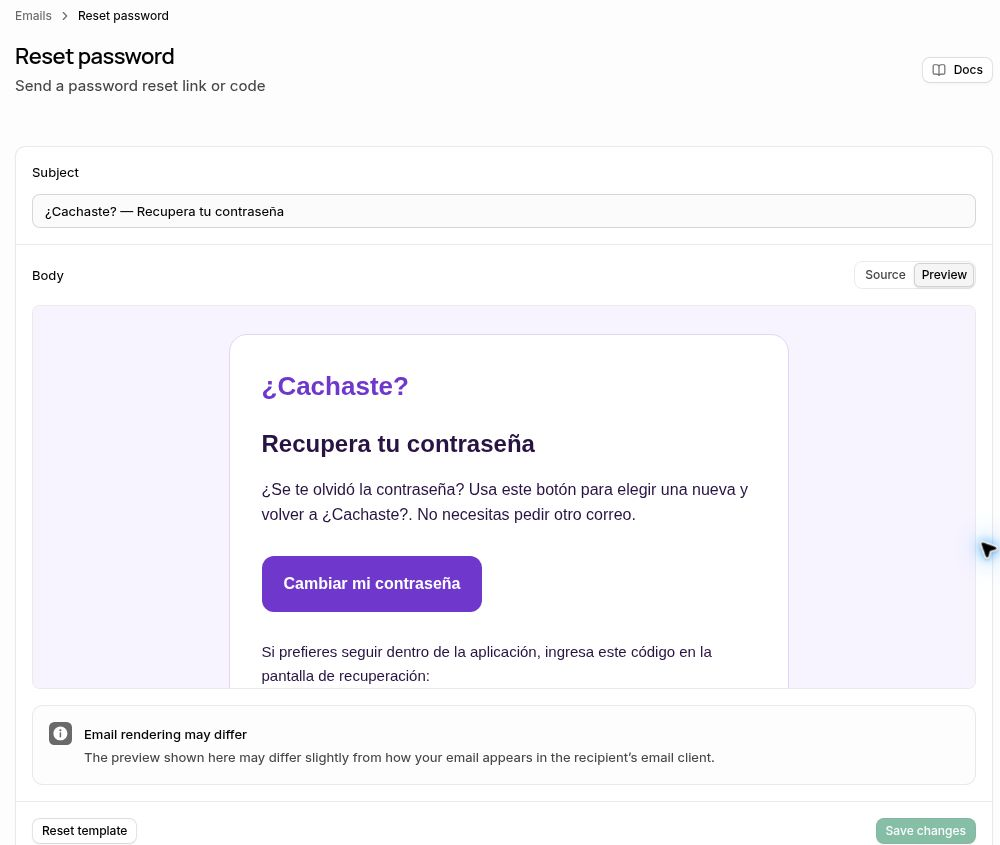

# ¿Cachaste? · Recuperación corregida, publicada y correo real verificado

La corrección web está publicada y Supabase ya envía el correo nuevo en español. Se verificó una solicitud real desde la página pública y su recepción en Gmail. **La validación final en un teléfono físico, con una contraseña elegida por el titular, sigue pendiente.**

| Entrega | Evidencia |
|---|---|
| Página pública | https://work-cachaste-web-comercial.cachaste-sitecacho.pages.dev/recuperar |
| Commit de implementación | `9e45078a895276c9003450a494389a017c10450b` |
| Commit desplegado | `d0d7e747b7afd217fe52ad55f26021a7974d7395` |
| Despliegue inmutable | https://0085f006.cachaste-sitecacho.pages.dev |
| Cloudflare Pages Free | [Publicación aprobada](https://github.com/josevillablanca30/PreparaTupaes/actions/runs/41632426361) |
| QA del mismo commit | [Pruebas aprobadas](https://github.com/josevillablanca30/PreparaTupaes/actions/runs/41632426358) |
| Estado Supabase | Plantilla y asunto aplicados y verificados después de recargar el panel; ninguna configuración manual pendiente |

## Causa y corrección

La configuración Android vigente contiene `authReturnUrl: null`. Su método `resetPassword` omite `redirectTo` y Supabase utiliza el Site URL. La plantilla alojada anterior, en inglés, usaba `ConfirmationURL`; el retorno implícito llegaba a la portada con los datos de recuperación en el fragmento. La portada no procesaba ese retorno. Abrir después `/recuperar` manualmente no trasladaba esos datos y mostraba correctamente el formulario de solicitud.

La portada ahora captura el retorno antes de realizar otras operaciones, limpia la URL y muestra la misma página de recuperación existente. También reconoce errores del proveedor, hashes y códigos PKCE anteriores. Una navegación de fragmento en una pestaña ya abierta también se procesa. No se reenvían las credenciales a otra URL.

Las nuevas solicitudes web usan un cliente oficial de Supabase de solo solicitud, sin desafío PKCE, para permitir abrir el correo en otro navegador. El acceso Google conserva PKCE. Los códigos PKCE de recuperación anteriores siguen funcionando con su verificador original; un código OAuth ordinario no habilita la pantalla de cambio de contraseña. La validación emplea `verifyOtp`, `setSession` o `exchangeCodeForSession`, según el retorno, y comprueba la identidad con `getUser` antes de `updateUser`.

El empaquetado web conserva el diseño original y reutiliza el cuerpo de `recuperar.html` como plantilla de la portada. La portada tiene ahora `private, no-store` y `no-referrer`, porque los fragmentos son invisibles para el servidor. El service worker evita almacenar callbacks. El cliente competitivo web solicita directamente `/recuperar`. No se modifica la candidata Android.

## Supabase y correo alojado

Se comprobó en el proyecto `jmobinmdwrmdqrxtcruj` que Site URL y los dos destinos autorizados ya eran correctos; no se alteraron. Se sustituyó completamente el cuerpo anterior y se guardó el asunto **¿Cachaste? — Recupera tu contraseña**. La plantilla coincide con `web/auth/recovery.html`, incluye el botón **Cambiar mi contraseña**, el código numérico compatible con Android y el aviso de seguridad. El enlace utiliza `/recuperar#token_hash=…&type=recovery`; el hash permanece en el fragmento, sin query.

Se verificó la persistencia tras recargar el panel y la recepción de un correo nuevo en Gmail. El mensaje real contiene exclusivamente el contenido español esperado, remitente ¿Cachaste?, URL HTTPS del sitio publicado y código Android. En esta prueba llegó a Recibidos, sin etiqueta Spam. SPF y DKIM aparecen aprobados en las cabeceras; no aparece un resultado DMARC. Esto no acredita la solución general de la clasificación de spam. No se modificaron DNS, SMTP, Resend ni claves privadas.

El workflow de configuración automática no tenía `SUPABASE_ACCESS_TOKEN`: su preflight falló y no realizó cambios. La aplicación de la plantilla se completó después mediante el panel autenticado del mismo proyecto. No se creó otro token.

## Pruebas y sus límites

- **120 pruebas web aprobadas**, incluida la regresión del backend, cifrado, recuperación, identidad y protección de pagos.
- **184 pruebas de navegador aprobadas**, 46 en cada perfil: Chrome Android, WebKit iPhone, Chrome escritorio y pantalla de 320 px. Son perfiles automatizados, no teléfonos físicos.
- **9 pruebas contra Auth y SMTP locales desechables aprobadas**: solicitud, plantilla española renderizada y recibida, hash entre navegadores, contraseña nueva, ingreso correcto, rechazo de la anterior, enlace expirado, reutilización, solicitud repetida, código del cliente Android, PKCE y retorno implícito a la raíz. La prueba utiliza el cliente Android de su rama remota vigente. El commit posterior solo corrige una expectativa del test de navegador y la solicitud de publicación; la aplicación es la misma. [Resultado](recovery-http.json).
- **205 comprobaciones HTTP del despliegue real aprobadas**: página, cliente, retorno de portada, versión, privacidad, contenido cifrado y cobros cerrados. [Resultado](pages-preview.json).
- **Tres verificaciones independientes de la dirección estable aprobadas**: commit exacto en `/version.json`, página `/recuperar` y plantilla de retorno en `/`. [Resultado](stable-http.json).
- **Chrome sobre el sitio publicado**: el retorno con hash sintético inválido desde `/` abrió recuperación, eliminó el fragmento y mostró un error seguro, sin volver a la portada.
- **Solicitud y recepción reales en Gmail aprobadas**, sin consumir el enlace real ni cambiar la contraseña del titular. [Resultado sin tokens ni código](correo-real.json).

## Única validación pendiente del titular

Abrir el mensaje más reciente desde su teléfono, tocar **Cambiar mi contraseña**, elegir y guardar una contraseña propia, volver a la app Android, iniciar sesión con la nueva y comprobar que la anterior sea rechazada. Las pruebas locales comprueban ese comportamiento del servidor, pero no sustituyen una recuperación real del titular en su dispositivo.

No queda configuración manual pendiente en Supabase. No se requiere ni se generó un AAB nuevo. Servicios Villablanca, pagos y suscripciones reales permanecen sin cambios.

[Resumen estructurado](resumen.json) · [Configuración comprobada](supabase-configuration.json).
